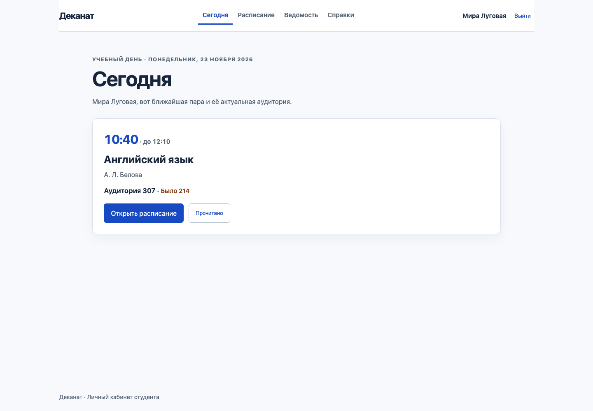
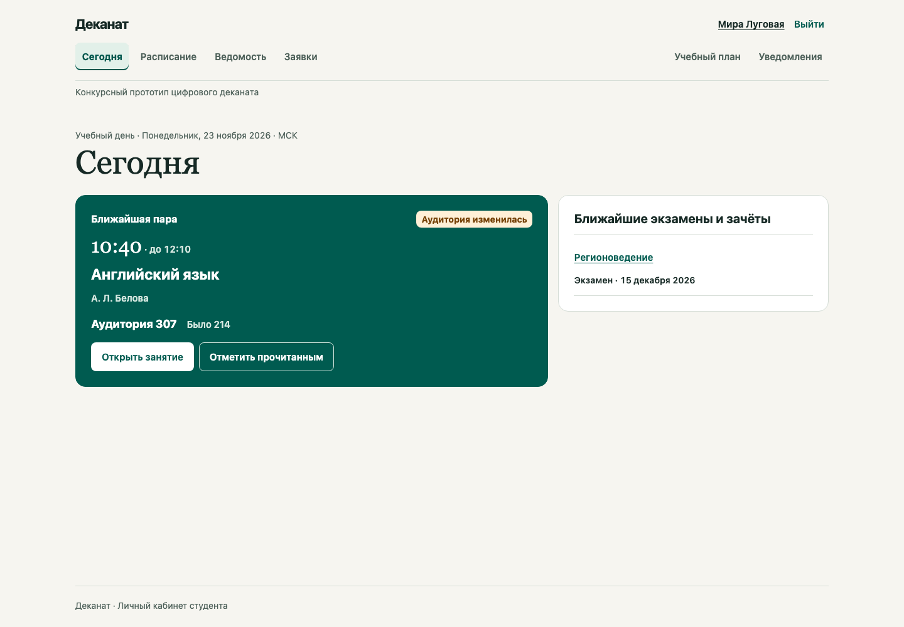
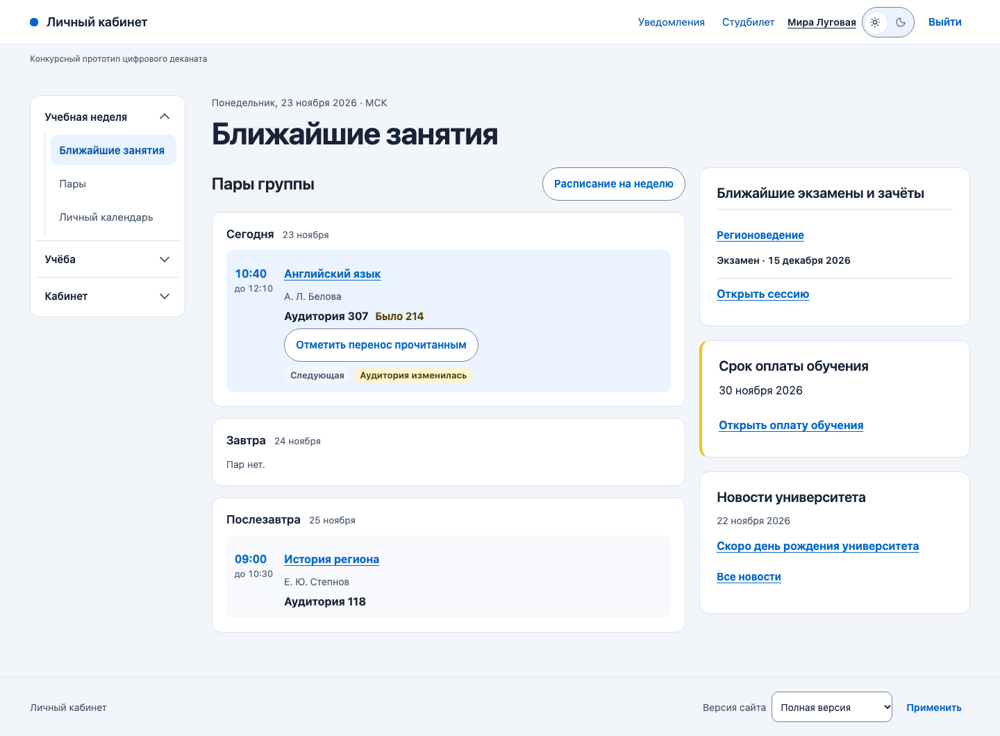
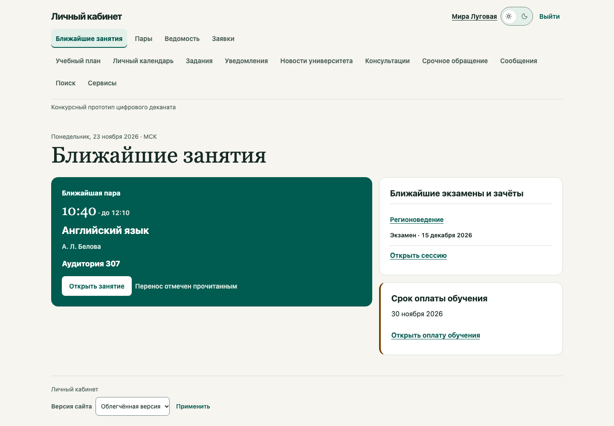

# Цифровой деканат · «Личный кабинет»

Рабочий прототип кабинета для MGIMO AI Challenge. Студент видит ближайшие занятия и переносы, ведомость, заявки и справки, календарь и сервисы кампуса. Учебный офис работает с расписанием, заявками и публикациями, преподаватель — с работами и ведомостью. Серверный HTML, Node.js, Hono и SQLite; полная и облегчённая версии оформления используют одну базу и один набор модулей.

## Как рос проект

Три этапа и три тега: история коммитов показывает, как первая встреча с расписанием стала полным кабинетом.

| Этап | Тег | Что появилось | Проверки |
| --- | --- | --- | --- |
| 20 ноября | [`v0.1-initial`](https://github.com/anyvladdy/mgimo-deanery/releases/tag/v0.1-initial) | Вход и профиль, расписание с переносом, ведомость, заявки, экран «Сегодня» | 19 |
| 21 ноября | [`v0.2-intermediate`](https://github.com/anyvladdy/mgimo-deanery/releases/tag/v0.2-intermediate) | Дизайн-система «Учебный день», учебный план, силлабусы, история результатов, рабочий стол офиса | 55 |
| 23 ноября | [`v1.0-final`](https://github.com/anyvladdy/mgimo-deanery/releases/tag/v1.0-final) | 39 модулей, полная и облегчённая версии, календарь, сдача работ, новости, срочные обращения | 130 |

**Первый кабинет.** Главное видно сразу: пара переехала из 214-й аудитории в 307-ю, рядом путь к занятию.



**«Учебный день».** Свой визуальный язык, иерархия и рабочий стол учебного офиса.



**«Личный кабинет».** Полная версия для широкого экрана и облегчённая — для слабых устройств и медленного интернета.





Больше экранов — в [`screenshots/`](screenshots), развитие замысла — в [PLAN.md](PLAN.md).

## Запуск демо

Нужны Node.js 22.23+ и npm. Из корня проекта:

```sh
npm ci
./start.sh
```

При первом запуске сохраняются локальная база и рабочая копия. Терминал один раз показывает логины и пароли. Откройте [вход студента](http://127.0.0.1:3100/login) или [вход сотрудника](http://127.0.0.1:3100/office/login). В подвале выбирается оформление.

Чтобы запустить копию готовой демонстрационной базы из поставки:

```sh
mkdir -p var
cp -n data/demo.sqlite var/demo.sqlite
export DEANERY_DB="$PWD/var/demo.sqlite"
npm run demo:setup
npm run demo:office
NODE_ENV=development PORT=3100 npm start
```

`demo:setup` выдаёт доступ студентам, `demo:office` — сотрудникам и настраивает получателей срочных обращений. В демонстрационной базе 15 вымышленных студентов. Состав модулей задаётся `DEANERY_MODULES`, например `full`, `core` или `full,-schedule`.

## Что внутри

- `src/` — модули: у каждого свои маршруты, схема и страницы; состав обнаруживается на старте.
- `data/production.sqlite` — чистая схема развёртывания с миграциями, `data/demo.sqlite` — демонстрационная база без аккаунтов и сессий.
- `deploy/` — HTTPS, постоянный том, первый администратор: [инструкция по развёртыванию](deploy/README.md).
- `tests/` — маршруты, роли, данные, конфигурации модулей и обновление SQLite. `npm test` — 130 проверок.
- `docs/` — [архитектура](docs/ARCHITECTURE.md), [Harness модулей](docs/HARNESS.md) и [API ассистента](docs/ASSISTANT-API.md).
- `.agents/` — проектные навыки для ИИ-ассистентов: [каталог](.agents/ECC-SKILLS.md) и [дизайн-навыки](.agents/DESIGN-SKILLS.md).

## Развёртывание

Чистая схема лежит в [`data/production.sqlite`](data/production.sqlite). Настройка HTTPS, постоянного тома и первого администратора описана в [инструкции](deploy/README.md). Для отдельного репозитория скопируйте содержимое проекта, включая `.agents`, `.gitignore` и `.dockerignore`, и выполните `git init -b main`, `git add .` и первый коммит. Аккаунтов в поставляемых базах нет: доступы выдаются на целевой копии.

## Документация

- [PLAN.md](PLAN.md) — как проект рос и куда может пойти.
- [AGENTS.md](AGENTS.md) — правила разработки модулей и совместной работы.
- [docs/ARCHITECTURE.md](docs/ARCHITECTURE.md) — маршруты и границы модулей.
- [docs/HARNESS.md](docs/HARNESS.md) — состав модулей и режимы.
- [docs/ASSISTANT-API.md](docs/ASSISTANT-API.md) — подключение ИИ-ассистента.
